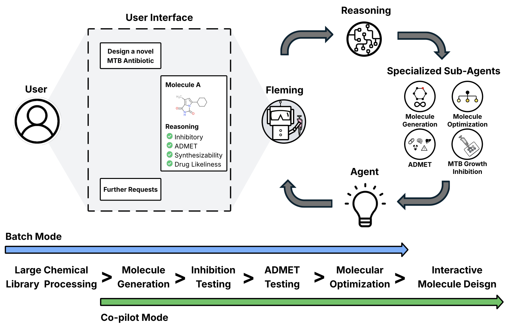

-----------------

# Fleming: An AI Agent for Antibiotic Discovery In Mycobacterium Tuberculosis

## What is Fleming?
Fleming is an agent designed to generate novel and plausible TB antibiotics. It consists of a central manager agent that orchestrates the actions of four specialized agents: the inhibition agent, ADMET agent, molecular generation agent, and molecular optimization agent. Together, these agents collaborate to fulfill user-defined tasks in antibiotic discovery. 

### Inhibition Agent
The inhibition agent takes a small molecule and predicts its inhibition of MTB using a model trained on data from 114,933 distinct molecules and their *in vitro* effect on TB growth. This inhibition model also identifies the molecular substructures contributing to its predictions. The agent then leverages an LLM model, GPT-4o, to assess the plausibility of the molecule based on its structure.

### ADMET Agent
The ADMET agent operates similarly, leveraging ADMET.AI molecular ML models to predict a small molecule's ADMET properties. After this step, the agent utilizes PaperQA2 to assess the same properties by reviewing relevant literature and lastly making a decision by combining molecular ML model predictions and literature.

### Molecular Generation Agent
The molecular generation agent utilizes a conditional small molecule diffusion model and a Monte-Carlo Tree Search model to design novel compounds that are filtered for synthesizability and novelty.

### Molecular Optimization Agent
The molecular optimization agent receives an input molecule and directs a secondary agent to identify structurally similar molecules in chemical space that exhibit enhanced ADMET properties. The optimal molecule is then sent back to the manager, which determines whether to proceed with further optimization or to conclude the process.

## Sample Requests
